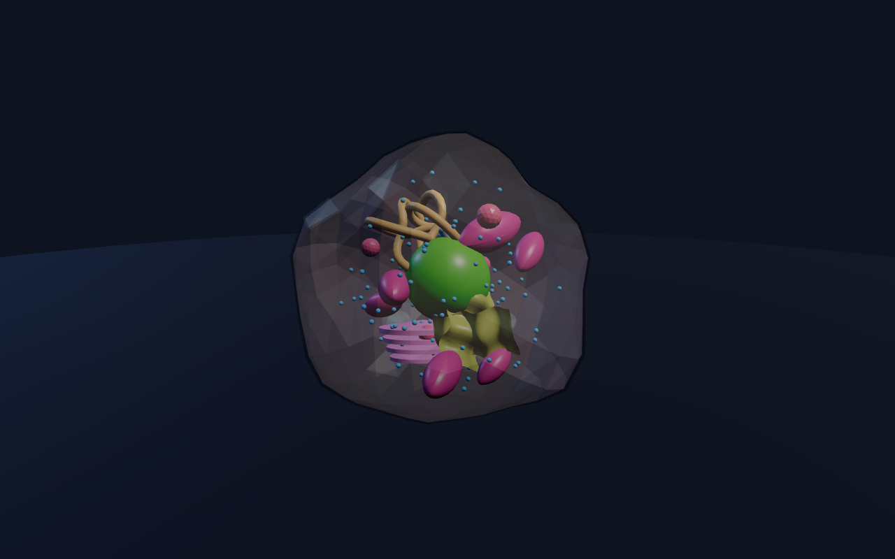
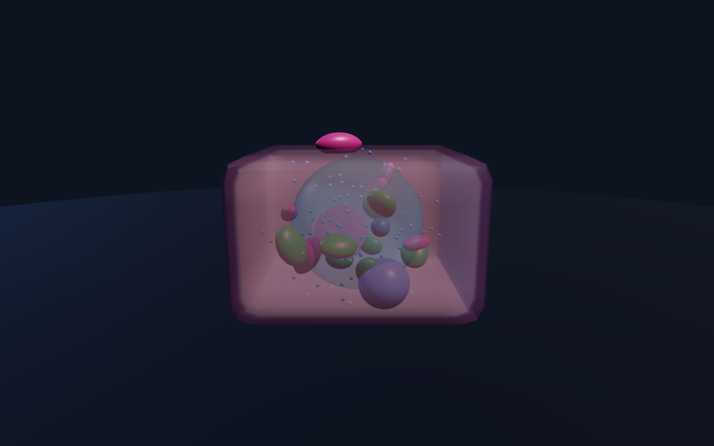
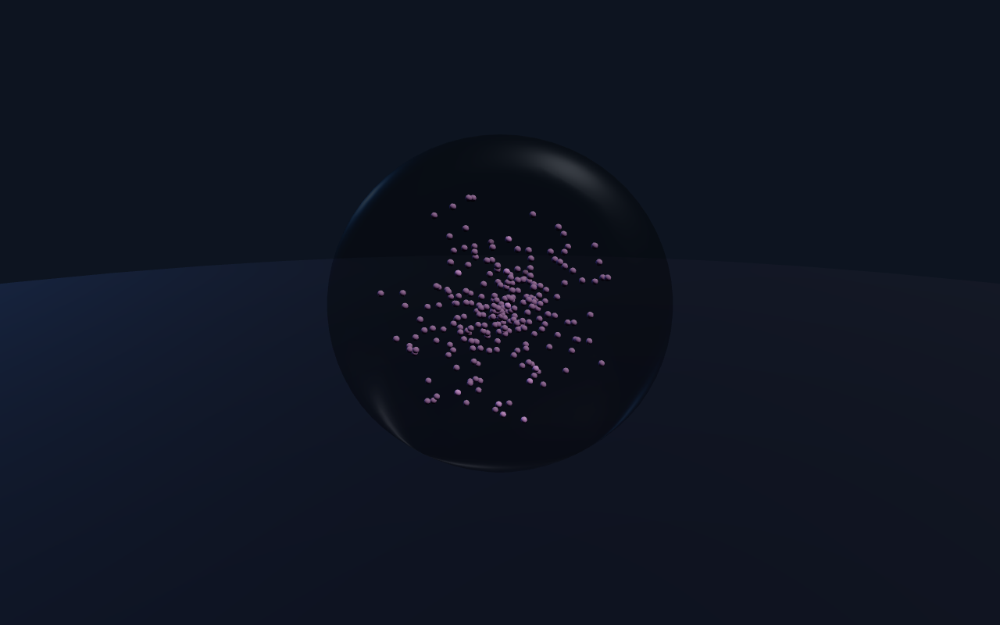
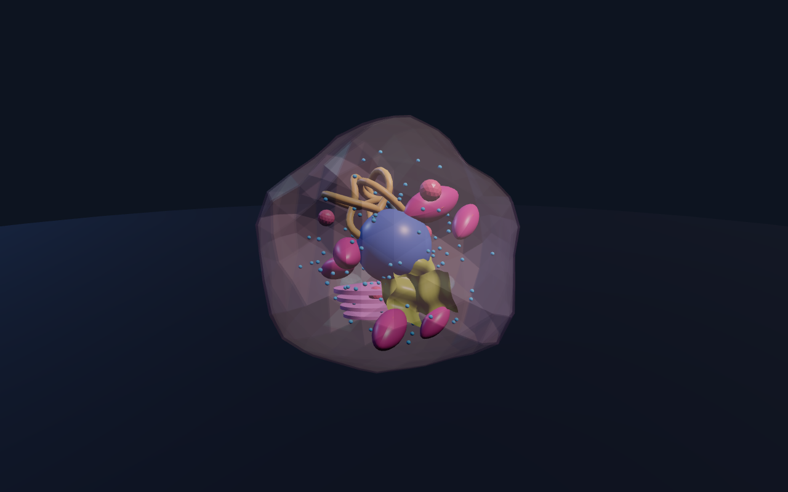
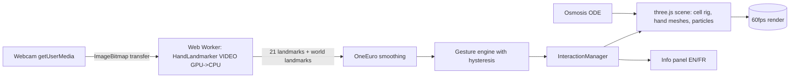

# Cell-Mastering

**An interactive 3D biology lab that runs in your browser.** You look at a living cell model on a
virtual laboratory bench — and soon you will grab, rotate, scale and dissect it with your **bare
hands**, tracked through your webcam (no gloves, no controllers, no headset). Pull an organelle out
to read what it does, then drop the cell into a beaker of hypotonic, isotonic or hypertonic saline
and watch osmosis happen in real time. A web app that lets you learn about cells, run experiments,
and develop deeper knowledge and understanding of biology.

> **Current status:** Phase 1 (3D cells) and Phase 2 (laboratory environment) are **built and
> verified working**. Phases 3–5 (hand tracking, info overlays, osmosis experiments) are planned —
> the architecture, physics model and gesture design are fully specified in
> [`docs/ARCHITECTURE.md`](docs/ARCHITECTURE.md). What runs today is controlled with the **mouse and
> keyboard** (which is also the permanent no-webcam fallback).

| Animal cell | Plant cell | Red blood cell | Explode view |
|---|---|---|---|
|  |  |  |  |

---

## 1. Overview

Cell-Mastering renders a complete laboratory in 3D (Three.js): a wooden bench, a microscope,
shelves of reagent jars, a whiteboard, and **three labelled beakers** — 0.2 % NaCl (hypotonic),
0.9 % NaCl (isotonic), 3.0 % NaCl (hypertonic). On the bench sits a procedurally generated cell you
can inspect part by part.

There are three cell types, each with every organelle as its **own named, selectable, editable
mesh**:

- **Animal cell** — translucent membrane, cytoplasm, nucleus with nucleolus, rough & smooth
  endoplasmic reticulum, Golgi stack, mitochondria (with cristae), lysosomes, ~120 ribosomes,
  centriole pair, small vacuoles.
- **Plant cell** — rigid rounded-box cell wall, plasma membrane, large central vacuole, peripheral
  nucleus, green chloroplasts (with grana stacks), mitochondria, Golgi, ribosomes.
- **Red blood cell** — biconcave disc filled with haemoglobin (the clearest osmosis demo).

Every organelle carries bilingual metadata (English + French): name, function, key facts,
approximate size and an everyday analogy, all stored as data in JSON — never hardcoded.

## 2. Features

**Shipped today**

- Procedural animal / plant / red-blood-cell models, one named mesh group per organelle.
- Part editor API (`src/cell/CellModel.ts`): show/hide, isolate, opacity, color override, highlight,
  **explode view**, full reset.
- Organelle + cell definitions loaded from `src/data/organelles.json` and `src/data/cells.json` —
  adding an organelle means editing only JSON (see §10).
- Full laboratory environment: bench, microscope, shelves with jars, whiteboard, 3 labelled
  beakers with colored liquids.
- PBR lighting: key + fill + rim + hemisphere, two accent spots, procedural studio environment map
  (PMREM) for reflections, soft shadows.
- **Low / high quality toggle** (`Q` key) that rebuilds lights, shadows, textures and geometry
  density at runtime — targets 60 fps on a mid-range laptop.
- Beaker **drop detection**: move the cell onto a beaker and the liquid reacts (hook ready for the
  osmosis simulation).
- Mouse-orbit camera fallback (drag to rotate, wheel to zoom) — always available.
- Research + architecture documentation with sources (`docs/`).

**Planned (design finalized, see docs/ARCHITECTURE.md)**

- Webcam hand tracking via MediaPipe Hand Landmarker (2 hands, VIDEO mode, GPU delegate with CPU
  fallback) running in a Web Worker, One Euro filter smoothing, pinch-grab / two-hand scale & twist
  / laser-point gestures with hysteresis, articulated 3D hand mesh, mirrored webcam PiP, calibration
  wizard.
- Info overlay panels (highlight + leader line + bilingual card) on selection/hover.
- Scientifically grounded osmosis simulator (`dV/dt = Lp·A(V)·ΔΨ`, van't Hoff potentials): animal
  cell swelling & lysis, crenation, plant turgor & plasmolysis, RBC haemolysis — with animated
  water/solute particles and a live volume graph.
- WebXR headset mode (architectural seam prepared, not built).

## 3. Tech stack

| Layer | Choice | Version (pinned) |
|---|---|---|
| Build/dev server | Vite | `8.3.4` |
| Language | TypeScript (strict) | `7.0.2` |
| 3D engine | three.js | `0.186.1` |
| Hand tracking | @mediapipe/tasks-vision (HandLandmarker, 21 landmarks, 2 hands) | `1.1.0` |
| Unit tests | Vitest | `5.0.4` |
| E2E smoke tests | Playwright (Chromium fake-camera flags) | `1.64.0` |

MediaPipe **wasm binaries and the `hand_landmarker.task` model are hosted locally** under
`public/` (copied by `scripts/fetch-assets.mjs` on install) — the app does not depend on a CDN at
runtime and works offline.

## 4. Architecture

Data flow — webcam pixels never reach the render loop; inference lives in a worker:



Key modules (each one small, documented, testable):

| Module | Role |
|---|---|
| `src/scene/SceneManager.ts` | renderer/camera/resize/DPR, quality presets, `MouseOrbit` fallback; `enableXR()` stub = WebXR seam |
| `src/scene/Lighting.ts` | PBR rig + procedural PMREM environment |
| `src/scene/LabEnvironment.ts` | bench, microscope, shelves, whiteboard, beakers + drop zones |
| `src/cell/shapes.ts` | geometry factories (body shapes + per-organelle shapes) |
| `src/cell/CellModel.ts` | assembles a cell from a spec; part API (visibility, opacity, color, explode, isolate, highlight, raycast targets) |
| `src/data/*.json` | **all** organelle/cell metadata and layout — data-driven |
| `src/app/App.ts` | orchestrator: owns scene, lab, cell, input, frame loop |

Design rules: pure/DOM-free logic (`gestures`, `OneEuro`, `OsmosisSim`) is unit-testable; the
render loop reads the **latest** tracking result and never awaits inference; static lab geometry is
kept to a low draw-call budget. Full spec: [`docs/ARCHITECTURE.md`](docs/ARCHITECTURE.md).

## 5. Requirements

- Node.js ≥ 20 (developed against v24), npm ≥ 10.
- A WebGL2 browser (Chrome/Edge/Firefox recent).
- **Webcam** (Phase 3 only) — requires `localhost` or **HTTPS** (works on the GitHub Pages build).
- ~50 MB disk for `node_modules` + ~25 MB for MediaPipe assets (auto-downloaded once).
- Tested on Windows; runs on anything Vite/Chromium runs on.

## 6. Quick start

```bash
git clone https://github.com/UlkhadPharaon/Cell-Mastering.git
cd Cell-Mastering
npm install        # also fetches MediaPipe wasm + model into public/ (postinstall)
npm run dev        # http://localhost:5173
```

Other commands:

```bash
npm run build      # typecheck + production build to dist/
npm run preview    # serve the built app locally
npm run typecheck  # tsc --noEmit only
npm test           # vitest unit tests (gesture engine, filters, osmosis)
npm run test:e2e   # Playwright smoke test (fake camera)
```

## 7. Controls

**Current (mouse + keyboard — this is also the permanent fallback):**

| Input | Action |
|---|---|
| Drag (left button) | Orbit camera around the lab |
| Mouse wheel | Zoom in / out |
| `1` / `2` / `3` | Switch cell type: animal / plant / red blood cell |
| `E` | Cycle explode-view amount |
| `R` | Reset all parts (visibility, color, explode) |
| `Q` | Toggle low / high graphics quality |
| `C` | Re-center the cell on the bench |

**Planned (Phase 3 hand gestures — will replace the mouse, same semantics):**

| Gesture | Action |
|---|---|
| Pinch (thumb + index) | Grab the cell / an organelle |
| One hand, drag | Move the cell; wrist rotation turns it |
| Two-hand pinch, move apart/together | Scale the cell |
| Two-hand twist | Rotate the cell around its axis |
| Index pointing | Laser ray for hover/selection |
| Pinch while pointing / hover-dwell | Select an organelle |
| Open palm | Release |

## 8. The experiments (the science)

> Shipped as interactive sims in Phase 5; the full model is specified in `docs/ARCHITECTURE.md §6`
> and research sources in `docs/RESEARCH.md §4`. Here is what will run and why it's correct.

Water crosses the cell membrane **down its own concentration gradient** — from the side with fewer
dissolved particles to the side with more. The driving force is the water-potential difference:

```
Ψs = −i·C·R·T          (van't Hoff solute potential; i ≈ 1.9 for NaCl)
dV/dt = Lp · A(V) · ΔΨ  (membrane hydraulic conductivity Lp, surface A grows as V^(2/3))
```

- **Hypotonic (0.2 % NaCl)** — outside has *fewer* solutes than the cytoplasm ⇒ water rushes **in**.
  Animal cell & RBC **swell and lyse** past ~1.45–1.6× volume (no wall). Plant cell becomes
  **turgid**: the wall's elastic pressure exactly cancels the osmotic gradient, so it *cannot burst*.
- **Isotonic (0.9 % NaCl)** — equal concentrations ⇒ dynamic equilibrium, volume **stable**.
  (This is physiological saline — the same reason IV drips use it.)
- **Hypertonic (3.0 % NaCl)** — outside is saltier ⇒ water leaves the cell. Animal cell & RBC
  **crenate** (shrink and scallop). Plant cell undergoes **plasmolysis**: the membrane and
  protoplast visibly pull away from the rigid wall, which keeps its shape.

The simulator integrates that ODE with a fixed timestep and drives everything from it — membrane
volume, crenation/plasmolysis morphs, particle traffic across the membrane, and a live V(t) graph —
so the visuals are literally a plot of the physics.

## 9. Project structure

```
Cell-Mastering/
├── index.html                 # app shell
├── public/
│   ├── mediapipe-wasm/        # wasm binaries (fetched on npm install, gitignored)
│   └── models/
│       └── hand_landmarker.task  # MediaPipe model, 7.8 MB, committed → offline by default
├── scripts/
│   ├── fetch-assets.mjs       # postinstall: copy wasm from package, download model
│   └── probe.mjs              # headless render check
├── src/
│   ├── app/App.ts             # orchestrator + frame loop
│   ├── scene/                 # SceneManager, Lighting, LabEnvironment
│   ├── cell/                  # shapes.ts (factories), CellModel.ts (assembly + part API)
│   ├── data/                  # organelles.json, cells.json, catalog.ts (loader)
│   ├── util/                  # math.ts (seeded RNG, geometry helpers)
│   ├── types.ts               # shared interfaces (CellSpec, OrganelleMeta, Intent…)
│   └── main.ts                # entry
├── docs/
│   ├── RESEARCH.md            # sources + every technical decision with rationale
│   ├── ARCHITECTURE.md        # modules, data flow, Mermaid, physics, testing plan
│   └── screenshots/           # rendered previews
├── tests/                     # vitest unit tests + Playwright e2e (Phase 3+)
├── vite.config.ts  vitest.config.ts  tsconfig.json  package.json
├── README.md  CREDITS.md  LICENSE  .gitignore
```

## 10. How to add an organelle (or a whole cell type)

**Add a new cell type:** create an entry in `src/data/cells.json` (id, kind, radius, osmosis
parameters, part list referencing existing organelle ids). Done — press the matching number key.

**Add a new organelle to an existing cell:**

1. **`src/data/organelles.json`** — add an entry: `id`, bilingual `name/function/facts/size/analogy`,
   `color`, optional `translucent`, `explodeDir`, optional `group`.
2. **`src/data/cells.json`** — add `{ "organelleId": "your-id", "count": N, "placement":
   "scatter|cluster|shell|nucleus-center", "radiusRange": [min,max], "baseSize": s }` to the cell's
   `parts` array.
3. *(Optional)* **`src/cell/shapes.ts`** — register a custom geometry factory in `SHAPES`. Skip it
   and the part automatically gets a generic organelle-like shape (the extensibility guarantee).

No TypeScript in the app itself changes: the metadata loader, the part editor, the exploder and the
picker all work from the data.

## 11. Assets, credits and licenses

See **[`CREDITS.md`](CREDITS.md)** for the full table. Summary:

- **Application code:** MIT.
- **All cell and lab geometry:** generated procedurally at runtime by this repo — no third-party
  3D models are shipped. NIH 3D / open-model alternatives were evaluated and their licenses or
  fused-print geometry didn't fit (rationale in `docs/RESEARCH.md §3`).
- **MediaPipe wasm + Hand Landmarker model:** Google, Apache-2.0 (redistributed locally, not modified).
- **three.js:** MIT. Fonts: system only.

## 12. Performance tips & troubleshooting

- **Low fps** → press `Q` for low quality (no shadows, no env map, cheaper geometry, DPR 1). On
  integrated GPUs this alone usually doubles frame rate.
- **White/grey translucent parts** → the PMREM environment failed to init on your driver (old
  Firefox/strict privacy flags); lights still work, reflections are dropped automatically.
- **Camera permission denied (Phase 3)** → browsers only allow webcam on `localhost` or HTTPS;
  on the GitHub Pages build use the Pages URL, on a LAN dev server use a tunnel or the Pages site.
- **Camera in use** → another app (Zoom/OBS/Teams) holds the device; close it and press Retry.
- **Blank dark scene** → WebGL2 unsupported or GPU blocklisted; try `--ignore-gpu-blocklist` in
  Chrome or another browser.
- The page pauses rendering when hidden automatically (`setAnimationLoop` semantics).

## 13. Roadmap

1. **Phase 3 — hand tracking:** MediaPipe worker pipeline, One Euro smoothing, gesture engine with
   hysteresis (+ unit tests with synthetic landmarks), depth from apparent hand size + world
   landmarks, procedural articulated hand mesh, mirrored PiP debug overlay, calibration wizard.
2. **Phase 4 — info overlay:** selection outline, leader line, following bilingual panel.
3. **Phase 5 — osmosis experiments:** volume ODE, lysis/crenation/turgor/plasmolysis morphs,
   water & solute particles, live graph, drag-into-beaker + slider controls.
4. **WebXR:** headset mode via `renderer.xr` (seam already in SceneManager).
5. More cell types (bacterium, neuron, palisade mesophyll) — data-only additions, plus mitosis
   explainer mode.

## 14. Contributing & license

- Fork, branch off `main`, keep commits conventional (`feat(cell): …`, `fix(gestures): …`).
- Run `npm run typecheck && npm test && npm run build` before opening a PR.
- Record any new asset (author, URL, license) in `CREDITS.md` — PRs adding third-party binaries
  without a license line won't pass review.
- **License: MIT** (see [`LICENSE`](LICENSE)). Third-party components keep their own licenses as
  listed in `CREDITS.md`.
