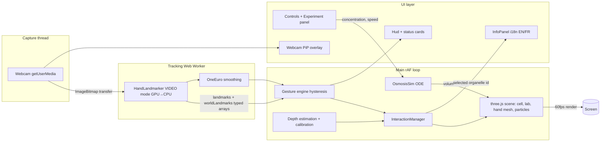

# Architecture — Cell-Mastering

Interactive 3D biology lab: a cell you manipulate with bare hands, tracked by webcam
(MediaPipe Hand Landmarker), rendered with three.js in a Vite + TypeScript app.

## 1. Module map

```
src/
  main.ts                  # entry: boots App, wires panels
  app/App.ts               # orchestrator: owns subsystems, frame loop, state machine
  core/
    EventEmitter.ts        # tiny typed bus — modules talk through events, not imports
    Settings.ts            # persisted user settings (quality, language, gains, thresholds)
    Quality.ts             # low/high presets applied to renderer + scene + particles
  scene/
    SceneManager.ts        # renderer/scene/camera/resize/DPR, XR-ready hook (stub)
    Lighting.ts            # PBR lights, shadows, optional HDRI (PMREM)
    LabEnvironment.ts      # procedural bench, microscope, shelves, whiteboard, beakers
    Beakers.ts             # 3 labelled beakers, concentration metadata, drop-zone volumes
  cell/
    CellModel.ts           # builds a named-mesh cell from a CellSpec; parts API
    cells/animalCell.ts    # procedural animal cell parts
    cells/plantCell.ts     # cell wall, chloroplasts, large central vacuole
    cells/redBloodCell.ts  # biconcave disc (osmosis star)
    PartEditor.ts          # show/hide, isolate, opacity, color, explode slider, reset
    Deformer.ts            # per-vertex morphs: osmotic volume, crenation, burst
  data/
    organelles.json        # ALL organelle metadata (id, name{en,fr}, function, facts, size, analogy)
    cellTypes.json         # which organelle ids each cell type contains + layout hints
  hand/
    HandTracker.ts         # getUserMedia + lifecycle/errors (permission, no cam, in use)
    TrackingWorker.ts      # worker: HandLandmarker (VIDEO, GPU→CPU fallback) + transfer bitmaps
    LandmarkBuffer.ts      # shared typed-array protocol main<->worker, fps stats
    Smooth.ts              # OneEuroFilter (per landmark x,y,z + hand center)
    Depth.ts               # apparent-size depth + worldLandmarks meters + calibration params
    gestures.ts            # PURE state machine: pinch/grab/point/palm/two-hand (hysteresis)
    HandPose.ts            # 21-joint skeleton, bone vectors, hand frame (orientation)
    HandMesh.ts            # procedural articulated hand (capsules+spheres), per-hand
    InteractionManager.ts  # gestures + depth -> intents: grab(part), move, rotate, scale, select
    PipOverlay.ts          # mirrored webcam PiP + landmark canvas overlay (toggleable)
    Calibration.ts         # 3-step wizard: neutral, pinch, two-hands -> S0, gains, offsets
    MouseFallback.ts       # orbit/pointer raycast when no webcam (always available)
  ui/
    InfoPanel.ts           # organelle overlay: outline + leader line + follow panel
    Hud.ts                 # tracking status, fps, hand count, delegate (GPU/CPU)
    ControlsPanel.ts       # cell type switch, part editor, experiments, settings
    ExperimentPanel.ts     # play/pause/reset/speed, concentration slider, explanation text
    i18n.ts                # EN/FR dictionary + t() + language toggle
    StatusOverlay.ts       # camera error cards with recovery instructions
  experiments/
    OsmosisSim.ts          # dV/dt = Lp·A(V)·ΔΨ ODE, states: swell/lyse/crenate/turgid/plasmolyse
    Particles.ts           # water + solute animated particles, density ∝ concentration
    VolumeChart.ts         # live canvas graph V(t)
  types.ts                 # shared interfaces
```

Rules:
- `gestures.ts`, `Smooth.ts`, `Depth.ts`, `OsmosisSim.ts` are **pure, DOM-free** → unit-testable.
- Rendering never awaits inference: worker posts results into a buffer; main loop reads latest.
- Adding an organelle = edit `organelles.json` + add its mesh builder in `cells/*.ts`. Nothing else.

## 2. Data flow



## 3. Scene graph

```
Scene
├── LabEnvironment (merged static meshes: bench, shelves, microscope, whiteboard)
│   └── Beakers ×3 (hypotonic 0.2% | isotonic 0.9% | hypertonic 3% NaCl) [drop zones]
├── CellRig (group, positioned center-bench; hand-grab moves/rotates/scales this)
│   └── CellModel (active cell type)
│       ├── parts: Map<organelleId, Mesh|Group>   # membrane, nucleus, ER, Golgi, mito...
│       ├── Deformer (applies osmotic volume + shape morph to membrane/cytoplasm)
│       └── OsmosisParticles (water + solute Points, instanced)
├── HandLayer
│   ├── HandMesh left/right (procedural capsules + joints)
│   └── LaserPointer (index ray) + Reticle
├── Lights (key directional+shadow, fill, rim, ambient/HDRI IBL)
└── InfoAnchor (leader line start, world-space, panel projected to screen)
```

## 4. Interaction model (hand → world)

1. Worker emits per-hand: 21 normalized landmarks, 21 world landmarks (meters), handedness.
2. `Smooth`: OneEuro per scalar channel (minCutoff 1.0 Hz, beta 0.05 scale-tuned; dCutoff 1 Hz).
3. `Depth`: hand scale s = |wrist→middleMCP|; d = f(s/S0) clamped to interaction slab; S0 from
   calibration. Two-hand distance uses worldLandmarks (meters) — more stable.
4. `gestures.ts` (Schmitt triggers, min hold 80 ms):
   - pinch enter 0.28 / exit 0.45 (thumb-index distance ÷ hand scale)
   - open palm (all 4 tips > 1.9× their MCP distance from wrist, pinch false) = release
   - index-point: tip8 extended, tips 12/16/20 curled → laser
   - dwell 700 ms on a part OR pinch while pointing = select
   - two-hand: both pinched → Δ distance = scale (gain slider), Δ angle of hand-axis = twist rotate
5. `InteractionManager` maps intents:
   - one-hand grab cell → attach CellRig to hand world position; wrist-forward drag;
     forearm yaw/pitch rotates cell (with smoothing so rotation ≠ position jitter)
   - grab organelle (ray under pinch) → detach visually along explode vector, hold in hand
6. Every numeric above is exposed in Settings (hence sliders) — tuning is a UI action, not a rebuild.

## 5. Camera error state machine

```
idle → requesting → live
requesting → denied(NotAllowedError)         → "Enable camera in browser settings…"
requesting → not-found(NotFoundError)        → "No camera detected. Plug in / check privacy shutter."
requesting → in-use(NotReadableError)        → "Camera busy: close Zoom/OBS… then Retry."
requesting → insecure-context                 → "Webcam needs localhost or HTTPS — open the Pages URL."
live → lost → auto-retry ×3 → manual retry card
```

## 6. Osmosis physics (see RESEARCH.md §4 for sources)

State per sim tick (fixed dt = 1/120 s, speed multiplier, accumulator):
```
Ψ_out  = -i·C_out·R·T          (i=1.9 NaCl, C mol/L, R=8.314, T=310 K)
Ψ_in   = -i·C_in·R·T·(V0/V)    (internal solute amount conserved ⇒ concentration ∝ 1/V)
Ψ_p    = 0 (animal/RBC) | k_wall·(V-V_wall)^1.5 clamp (plant wall elasticity)
ΔΨ     = (Ψ_in + Ψ_p) - Ψ_out
dV/dt  = Lp · A(V) · ΔΨ · v̄w   (A(V)=A0·(V/V0)^(2/3); water molar volume converts flux→dV)
Animal/RBC: V ≥ V_lyse ⇒ status=LYSED (burst visual, sim freezes)
Plant: V ≥ V_wall ⇒ turgid plateau (never lyses); protoplast volume < wall void ⇒ PLASMOLYSED
```
Visual mapping: membrane + cytoplasm scale ∝ (V/V0)^(1/3); RBC/animal crenation = noise-amplitude
morph when V/V0 < 0.85; turgid = membrane presses wall; plasmolysis = protoplast group shrinks
inside rigid wall mesh. Water particle count crossing membrane ∝ |dV/dt|, direction by sign;
solute outside density ∝ C_out.

## 7. Rendering & performance budget

- Target: 60 fps on a laptop-class iGPU/RTX3050. DPR clamp: high 2.0, low 1.0.
- Shadows: high = one directional light with 1k map + PCFSoft; low = off (baked-look ambient).
- HDRI (CC0, ≤2 MB env) only in high; low uses 3-light rig.
- Draw calls: static lab merged into ≤3 meshes; ribosomes/mitochondria instanced; ≤80 calls total.
- Textures: procedural canvas textures ≤512²; no binary image assets besides model+wasm.
- Quality toggle rebuilds light/shadow/particle config at runtime (no reload).
- WebXR seam: `SceneManager.enableXR(stub)` — renderer.xr left disabled; camera control is an
  interface (`CameraRigController`) so a future XR rig replaces only that class.

## 8. Testing strategy

- vitest: gestures (hysteresis no-flicker with noisy synthetic landmarks), two-hand scale/rotation
  math, OneEuro convergence, depth calibration monotonicity, osmosis ODE (lysis threshold, plant
  turgor plateau, plasmolysis flag, isotonic stability, energy sanity = volume never negative).
- Playwright smoke: fake camera flags, page load, WebGL context, zero console errors, HUD present.
- Manual (user only): real-hand ergonomics — thresholds/gains shipped adjustable.
